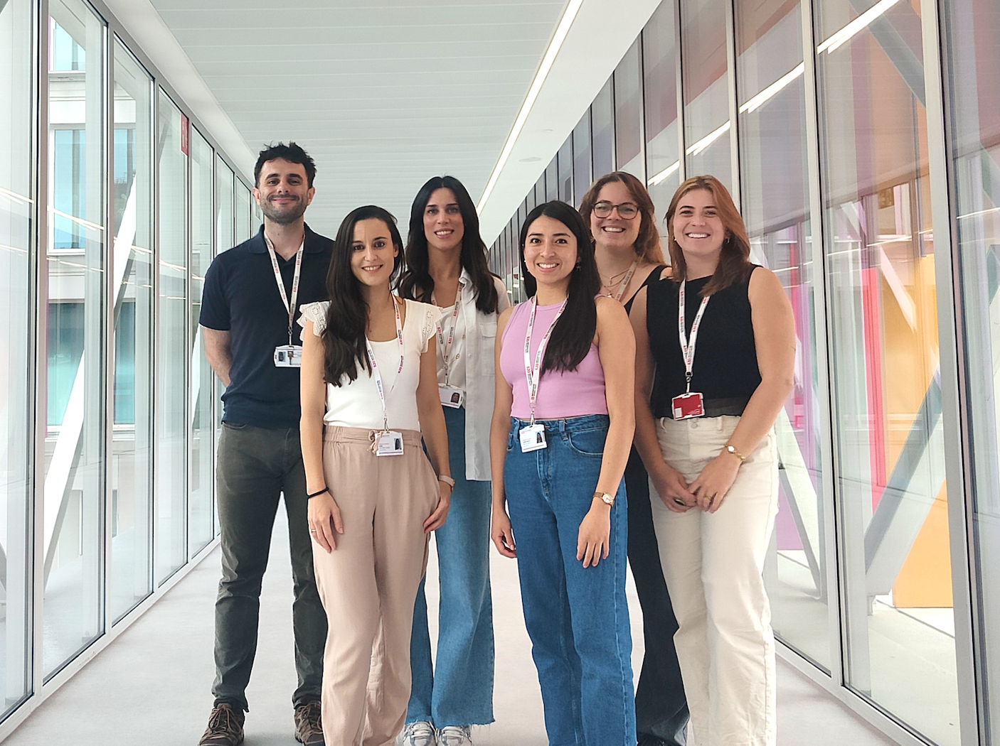
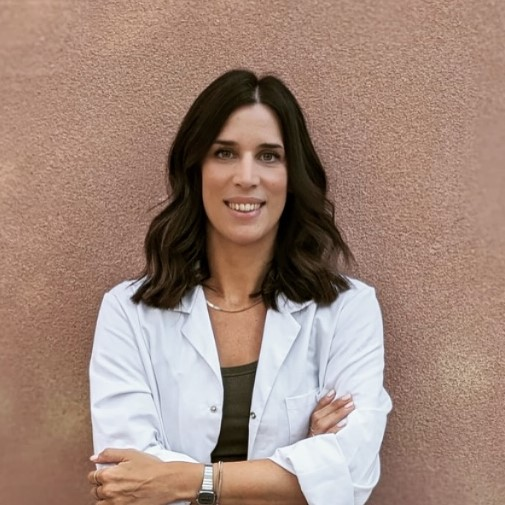
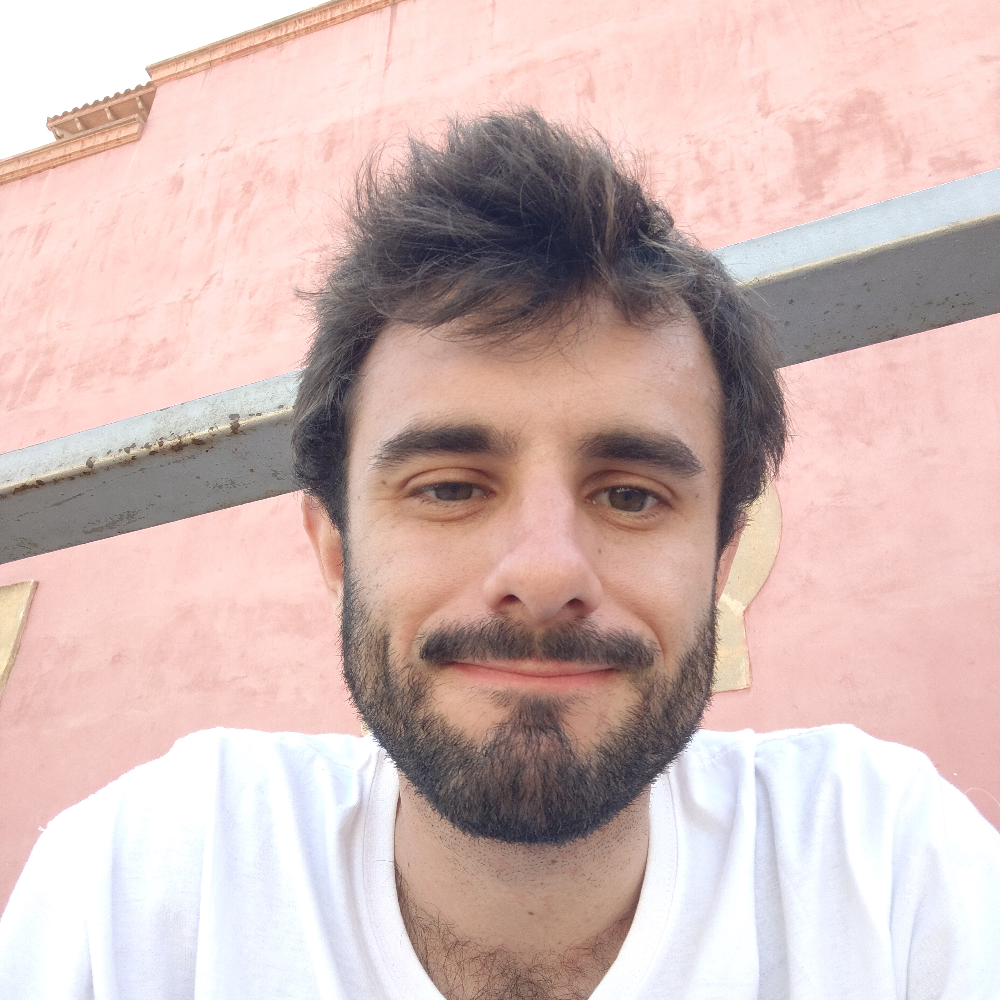
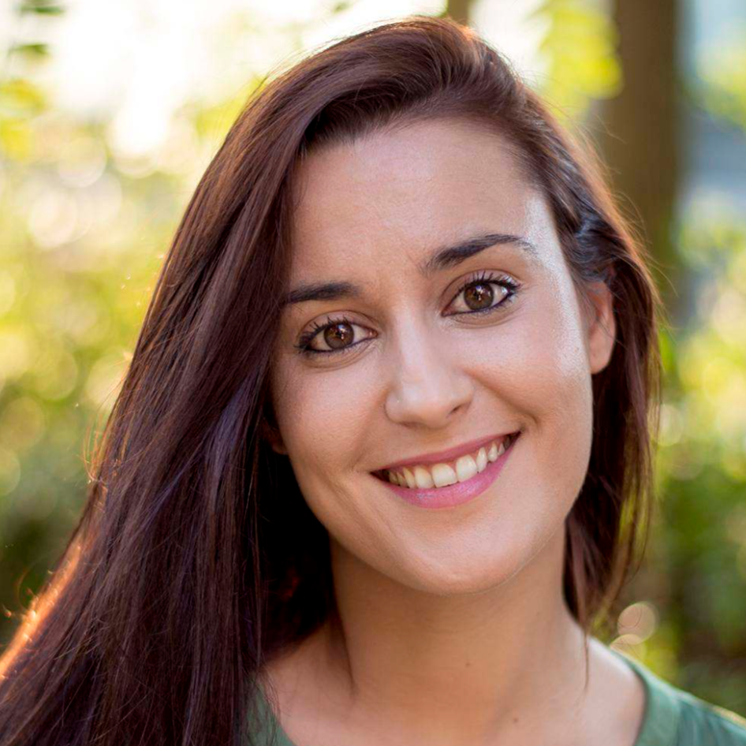
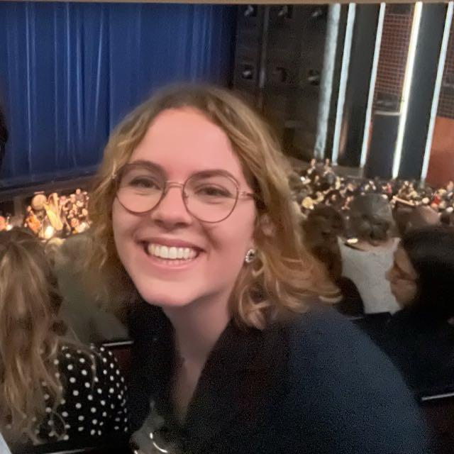
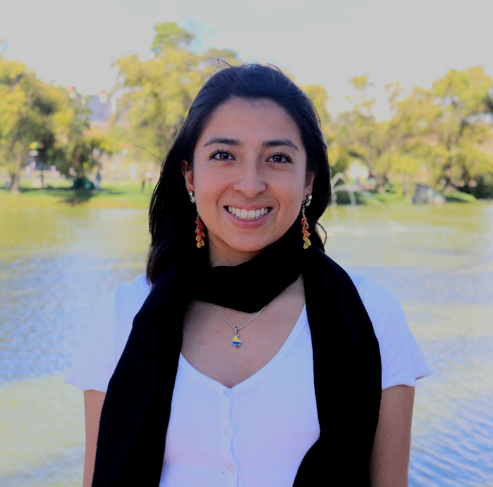
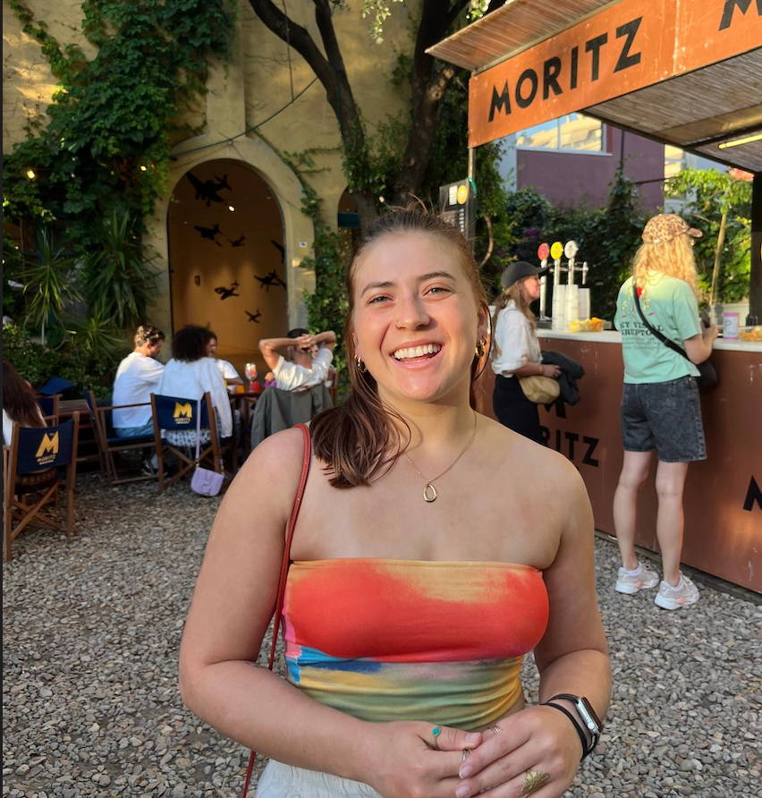

# People

::: small-subtitle

Meet current and former members and collaborators of the NeuroDevCo research group!

:::

<link rel="stylesheet" href="https://cdnjs.cloudflare.com/ajax/libs/font-awesome/6.7.2/css/all.min.css" integrity="sha512-Evv84Mr4kqVGRNSgIGL/F/aIDqQb7xQ2vcrdIwxfjThSH8CSR7PBEakCr51Ck+w+/U6swU2Im1vVX0SVk9ABhg==" crossorigin="anonymous" referrerpolicy="no-referrer"/>

 

<h2>Dr. Chiara Santolin (Principal Investigator & Group Leader)&nbsp;&nbsp;&nbsp;&nbsp;&nbsp;<a href="mailto:chiara.santolin@sjd.es" ><i class="fas fa-envelope text-dark"></i></a>&nbsp;&nbsp;&nbsp;<a href="https://scholar.google.com/citations?user=j-liw-wAAAAJ" target="_blank"><i class="fas fa-graduation-cap text-dark"></i></a>&nbsp;&nbsp;<a href="https://twitter.com/chiara_santolin" target="_blank"><i class="fab fa-twitter text-dark"></i></a>&nbsp;&nbsp;<a href="https://orcid.org/0000-0002-8361-5574" target="_blank"><i class="fa-brands fa-orcid text-dark"></i></a>&nbsp;&nbsp;</h2>

{width="300px" style="float: right; margin: 5px 15px 5px 15px; border-radius: 50%;"}

I am a cognitive scientist specializing in language acquisition and comparative cognition. I serve as a Principal Investigator at the Institut de Recerca Sant Joan de Déu and I lead the NeuroDevCo group. My research explores the types of cognitive mechanisms serving the early stages of language learning in humans. To tackle this problem, I take a comparative perspective, investigating how newborns and infants as well as other animals detect linguistic structures from the speech signal.

I earned my PhD in Psychology from the University of Padova (Italy) in 2016, with a specialization in animal cognition. After completing my doctorate studies, I did a post-doctoral training at the University of Wisconsin–Madison (USA) focusing on infant language learning. I then joined the Center for Brain and Cognition at Universitat Pompeu Fabra (Barcelona, Spain) as post-doctoral fellow where I mainly worked on the acquisition of syntax and syllabic structures, categorization processes and preferences for speech in infants, and learning of linguistic constraints in rats.

In 2024, I was awarded an ERC Starting Grant (European Union) for my project Gates to Language (GALA), which aims at investigating the origins of neural and cognitive mechanisms at the onset of language learning, testing humans at different developmental stages (0 to 10 month old), rats as animal model, and different sensory inputs (linguistic, auditory non-linguistic, and vibro-tactile).

 

## Post-doctoral researchers

<h3>Gonzalo García-Castro&nbsp;&nbsp;&nbsp;&nbsp;&nbsp;<a href="mailto:gonzalo.garcia@sjd.es" target="_blank"><i class="fas fa-envelope text-dark"></i></a>&nbsp;&nbsp;&nbsp;<a href="https://scholar.google.com/citations?user=fHetiuQAAAAJ" target="_blank"><i class="fas fa-graduation-cap text-dark"></i></a>&nbsp;&nbsp;<a href="https://orcid.org/0000-0002-8553-4209" target="_blank"><i class="fa-brands fa-orcid text-dark"></i></a>&nbsp;&nbsp;<a href="https://twitter.com/gongcastro" target="_blank"><i class="fab fa-twitter text-dark"></i></a>&nbsp;&nbsp;<a href="https://www.linkedin.com/in/gongcastro/" target="_blank"><i class="fa-brands fa-linkedin-in text-dark"></i></a>&nbsp;&nbsp;<a href="https://bsky.app/profile/gongcastro.bsky.social" target="_blank"><i class="fa-brands fa-bluesky text-dark"></i></a>&nbsp;&nbsp;<a href="https://hub.docker.com/u/gongcastro" target="_blank"><i class="fa-brands fa-docker text-dark"></i></a>&nbsp;&nbsp;<a href="https://github.com/gongcastro" target="_blank"><i class="fab fa-github text-dark"></i></a></h3>

{width="200px" style="float: right; margin: 5px 15px 5px 15px; border-radius: 50%;"}

I am a post-doctoral researcher investigating language acquisition and how young minds make sense of the world. My work focuses on developmental psychology and psycholinguistics, studying how humans process language at different stages in development: from newborns to infants, toddlers, and adults. Under the GALA project, I investigate how neonates, infants, and non-human animals process different syllabic structures, searching for common mechanisms supporting language processing. To do this, I use a combination of eye-tracking, functional near-infrared spectroscopy (fNIRS), and computational modelling. with a special focus on computational reproducibility. Bayesian statistics are a big part of how I try to make sense of data.

In 2024 I obtained my PhD at the Center for Brain and Cognition, Universitat Pompeu Fabra, supervised by Prof. Núria Sebastian-Galles. I earned my BSc in Psychology from the Universidad de Oviedo in 2013, and my MSc in Neurosciences at the Universitat de Barcelona in 2018.

 

<h3>Anna Martinez Álvarez&nbsp;&nbsp;&nbsp;&nbsp;&nbsp;<a href="mailto:anna.martineza@sjd.es" target="_blank"><i class="fas fa-envelope text-dark"></i></a></h3>
{width="200px" style="float: right; margin: 5px 15px 5px 15px; border-radius: 50%;"}
I am a postdoctoral associate researcher investigating early language acquisition from a developmental cognitive neuroscience perspective. My research focuses on newborns and young infants, examining how the developing brain processes speech and how attention and memory processes support language acquisition. To address these questions, I combine behavioral measures, eye-tracking, and functional near-infrared spectroscopy (fNIRS) to study the cognitive and neural processes underlying early language development. 

I earned my PhD in Brain, Cognition and Behavior from the University of Barcelona in 2018, under the supervision of Prof. Ruth de Diego-Balaguer and Prof. Ferran Pons. As part of the ERC Starting Grant TuningLang, I investigated the development of temporal orienting of attention and its role in language rule learning across infancy, childhood, and adulthood. After my doctoral studies, I joined the Integrative Neuroscience and Cognition Center (INCC) at Université Paris Cité, France, as a postdoctoral fellow within the ERC Consolidator Grant BabyRhythm, working with Prof. Judit Gervain. In 2020, I joined the Department of Developmental Psychology and Socialization at the University of Padova, Italy. During my postdoctoral research, I focused on the neural mechanisms involved in neonatal speech processing and infant language learning.

After a four-year career break from academia (2022–2026), during which I worked as a teacher and was on maternity leave, I recently resumed my academic career by joining the ERC Starting Grant GALA, led by Dr. Chiara Santolin in the Research Institute Sant Joan de Déu in Barcelona, where I investigate speech segmentation in newborns using fNIRS.

 

## PhD students

<h3>Flora Chartier&nbsp;&nbsp;&nbsp;&nbsp;&nbsp;<a href="mailto:flora.chartier@sjd.es" target="_blank"><i class="fas fa-envelope text-dark"></i></a>&nbsp;&nbsp;<a href="https://github.com/Floraachr" target="_blank"><i class="fab fa-github text-dark"></i></a></h3>

{width="200px" style="float: right; margin: 5px 15px 5px 15px; border-radius: 50%;"}

I am a PhD student at Universitat Pompeu Fabra in Barcelona, enrolled in the PhD Program in Biomedicine. I am interested in the early acquisition and processing of language by infants, using different techniques such as behavioral ones, eye-tracking and fNIRS.

I obtained my MSc in Integrative Biology and Physiology, specialized in Behavioral Neurosciences in La Sorbonne Université and spent a year working as a research engineer on the early acquisition of language in the INCC--Language & Cognition team in Paris. I am currently involved in the GALA project investigating how babies, at only a few months old, perceive syllables.

 

<h3>Laura S. Piracún-García&nbsp;&nbsp;&nbsp;&nbsp;&nbsp;<a href="mailto:laurasirley.piracun@sjd.es" target="_blank"><i class="fas fa-envelope text-dark"></i></a>&nbsp;&nbsp;<a href="https://github.com/laurapiracun" target="_blank"><i class="fab fa-github text-dark"></i></a></h3>

{width="200px" style="float: right; margin: 5px 15px 5px 15px; border-radius: 50%;"}

I am a PhD student as part of the GALA (Gate to Language) project. I am currently working on the perception and processing of language in Long-Evans rats, focusing on the comparative approach of language perception in human and non-human species. First, using operant conditioning, I test how rats, as the non-human species, process the acoustic signal that represents syllables. Furthermore, using vibrotactile stimuli, I will test the sensory bases of humans and non-human animals to process non-acoustic representations of syllables.

I obtained my MSc in International Experimental and Clinical Linguistics at the University of Potsdam (Potsdam, Germany), and my BA in Psychology at Bethany College (Kansas, USA). I am interested in understanding the mechanisms and strategies underlying the processing of the acoustic signal and how this ability has somehow been specialized to humans to be able to communicate with such a complex linguistic system.

 

## Project Coordinator 

<h3>Alyssa Álvarez&nbsp;&nbsp;&nbsp;&nbsp;&nbsp;<a href="mailto:alyssa.alvarez@sjd.es" target="_blank"><i class="fas fa-envelope text-dark"></i></a>&nbsp;&nbsp;<a href="https://www.linkedin.com/in/alyssa-alvarez-8a0a20271" target="_blank"><i class="fa-brands fa-linkedin-in text-dark"></i></a>&nbsp;&nbsp;<a href="https://github.com/Aalva20" target="_blank"><i class="fab fa-github text-dark"></i></a></h3>

</h3>

{width="200px" style="float: right; margin: 5px 15px 5px 15px; border-radius: 50%;"}

I am the Project Coordinator for the GALA project, where my role primarily involves assisting with the recruitment of participants, both adults and infants, and managing their visits to the lab. In the lab, I use a combination of eye-tracking and head-turn preference paradigms to explore early language acquisition and cognitive development.

I obtained my MSc in Brain and Cognition from Pompeu Fabra University (Barcelona, Spain). Prior to that, I earned a Bachelor’s degree in Neuroscience and Behavioral Biology from Emory University (Atlanta, USA).
Language acquisition has always been a central interest of mine. Through this work, I aim to contribute to uncovering the mechanisms that shape how we learn and process language

 

## Former members

<h3>Silvia Valls Santafé&nbsp;&nbsp;&nbsp;&nbsp;&nbsp;<a href="https://www.linkedin.com/in/silvia-valls-santafe-4a0679308/" target="_blank"><i class="fa-brands fa-linkedin-in text-dark"></i></a></h3>

<h3>Chara Sofocleous&nbsp;&nbsp;&nbsp;&nbsp;&nbsp;<a href="https://github.com/charasofocleous" target="_blank"><i class="fab fa-github text-dark"></i></a>&nbsp;&nbsp;<a href="https://www.linkedin.com/in/chara-sofocleous-b79848162/" target="_blank"><i class="fa-brands fa-linkedin-in text-dark"></i></a></h3>

<h3>Dilan Idil Kümet&nbsp;&nbsp;&nbsp;&nbsp;&nbsp;<a href="www.linkedin.com/in/idil-kümet-6669061b9" target="_blank"><i class="fa-brands fa-linkedin-in text-dark"></i></a></h3>

