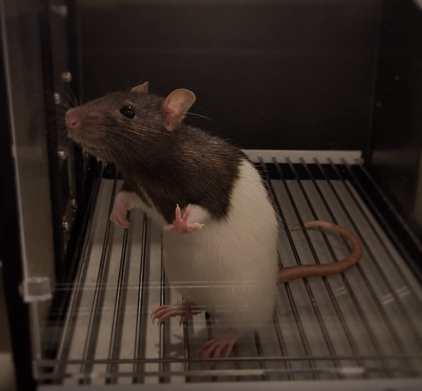

# Research

::: small-subtitle

Find out more about our studies!

:::

## Language Development 

:::: textbox

Our research explores how humans begin to learn language. By studying newborns, infants, adults, and other species, we investigate how the brain detects and organizes the basic sound patterns that form language. Ultimately, we aim to understand which mechanisms are specific to language and humans, and which arise from more general sensory and cognitive abilities.

::::

## Newborns

:::: textbox
Language is a very complex and structured communicative system yet most humans find it surprisingly easy to acquire language. What mechanisms support this readiness for language learning early in life? This is one of the main research questions at the NeuroDevComp group, which we address by studying newborns a few hours after birth.

To investigate this question, we study newborn babies within their first hours and days after birth. At this very early stage, newborns have had extremely limited experience with speech outside the womb, giving us a unique opportunity to investigate the foundations of language processing and the capacities that are already present at the start of life, allowing us to examine how the newborn brain responds to and organizes speech sounds.

We use a technique called fNIRS (functional Near-Infrared Spectroscopy) that allows to measure newborns' spontaneous neural activity when listening to auditory inputs (e.g., continuous speech, individual syllables and words). We are currently conducting these studies at the Sant Joan de Deu Barcelona Children Hospital.

::::

{style="width: 700px; height: 450px; object-fit: cover; object-position: center 65%; display: block; margin: 20px auto;"}

## Infants

:::: textbox

Our research here investigates how infants between 4 and 11 months of age detect and process the sound structure of speech, with a particular interest in how they begin to segment the continuous speech stream into smaller units, such as syllables.

One focus of our work is the Sonority Sequencing Principle (SSP), a phonological principle that describes how sounds are typically organized within syllables according to their relative sonority. Across languages, some sequences of sounds conform more closely to this pattern than others. We investigate whether infants are sensitive to these structural regularities and how they respond to syllables that follow or violate the SSP. By studying infants at different points during the first year of life, we can explore how sensitivity to these speech patterns develops alongside increasing experience with their native language or languages. To address this question, we use several techniques:

- Behavioural: We measure the time infants look at a computer screen while listening to different types of speech sounds.
- Eye-tracker: We track infants' gaze movements on the screen with great precision and also measure their pupil dilation when they hear speech sounds.
- fNIRS (functional near-infrared spectroscopy): We are interested in observing the activation of different brain areas when infants hear speech sounds.

::::

{style="width: 700px; height: 450px; object-fit: cover; object-position: center 65%; display: block; margin: 20px auto;"}

## Adults

:::: textbox

To understand how our linguistic environment shapes speech processing across development, we also study adult speakers with different language backgrounds.

Studying adults provides an important comparison for understanding how language processing develops across the lifespan. We investigate how adults perceive and process linguistic patterns, with a particular focus on the Sonority Sequencing Principle (SSP) and how prior language experience may shape sensitivity to these patterns.

Using behavioral tasks and eye-tracking, we examine participants' responses to different speech patterns while also measuring changes in pupil dilation as an indicator of processing effort. By comparing adults with newborns and infants, we can explore how sensitivity to speech structure changes over development and how it is shaped by experience with different languages.

::::

{style="width: 700px; height: 450px; object-fit: cover; object-position: center 65%; display: block; margin: 20px auto;"}

 

## Animal research

::: small-subtitle

Investigating the roots of language in other animal species.

:::

:::: textbox

Did you know that some of the mechanisms involved in processing language may not be unique to humans?

We take a comparative approach to investigate the biological mechanisms and phylogenetic origins of language acquisition using Long-Evans rats as a non-human model. Rats are particularly interesting because they are non-vocal learners: they cannot learn new vocalizations, yet they can perceive complex sounds, including speech, and discriminate features such as word boundaries, syllables, and differences between languages. This allows us to investigate whether some of the mechanisms humans use to process speech may originate from more general perceptual abilities rather than language itself.

Using a classical Skinner Box paradigm, rats first learn to nose-poke a sensor to receive a sugar pellet reward. They are then familiarized with a particular speech pattern and later tested with familiar and unfamiliar patterns to determine whether they can discriminate between them. We are currently using this approach to investigate the Sonority Sequencing Principle (SSP) and whether the perceptual mechanisms underlying sensitivity to these speech patterns are shared across species.

::::

{style="width: 700px; height: 450px; object-fit: cover; object-position: center 65%; display: block; margin: 20px auto;"}
